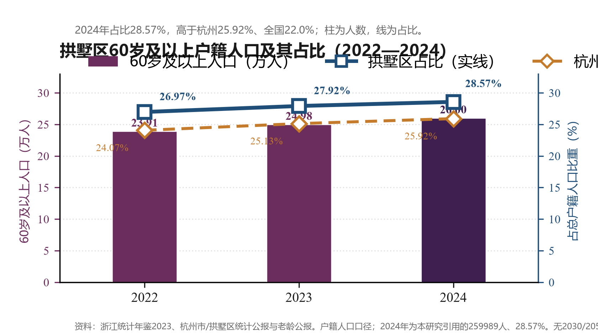

# 拱墅区老龄化与医疗资源分析

问题：拱墅区老龄化快于杭州和全国，医疗资源是否跟得上。

我的工作：收集公开统计与设施数据，整理字段，做对照分析，并把结果放进微信小程序。

## 主要结果

2024年拱墅区60岁及以上户籍人口占比 **28.57%**，高于杭州 **25.92%**、全国 **22.0%**。

柱为60岁及以上人数，折线为占总户籍人口比重。资料：浙江统计年鉴2023，杭州市/拱墅区统计公报与老龄公报。
